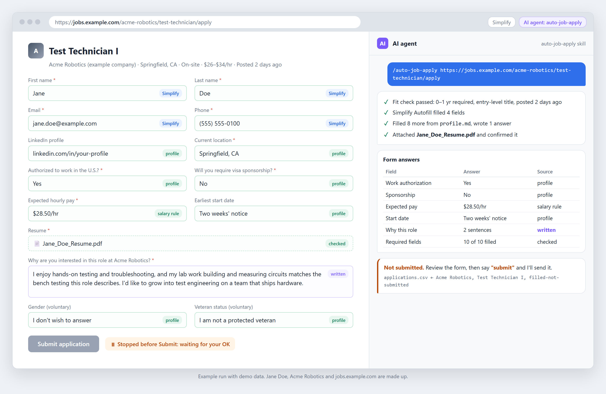

# auto-job-apply

[](https://github.com/antece1/auto-job-apply/releases/latest) [](LICENSE)

**Auto-apply to jobs with your AI agent.** An auto-apply skill for AI agent platforms that fills out job applications for you in your own Chrome, working alongside **Simplify**, **LinkedIn**, **Handshake** and **Sign in with Google**.

Paste job links, and the agent checks each job against your rules, fills the whole application from your profile, attaches your resume, and submits when you say so.



*Example run with demo data. Each field is tagged with where its answer came from (Simplify, your profile, the salary rule, or written by the agent), and the agent stops before Submit until you say "submit".*

## Works with

| | How |
|---|---|
| **AI agent platforms** | Installs as an agent skill (`SKILL.md`) on AI agents that support skills and can control Chrome through a browser extension |
| **Simplify** | Runs Simplify Copilot's **Autofill** first, then fills everything it missed and fixes anything it got wrong |
| **LinkedIn** | Paste LinkedIn job links. The agent follows **Apply** to the employer's form, and puts your LinkedIn profile on every application |
| **Handshake** | Paste Handshake job links. The agent follows **Apply** or **Apply externally** and fills the form |
| **Google** | Optional: lets the agent click **Sign in with Google** with the account you choose. It never types passwords or codes |
| **Company application sites** | Greenhouse, Lever, Ashby, Workday, iCIMS, BambooHR, SuccessFactors and other applicant tracking systems |

## What it does

For each job link:

1. Opens the posting and checks it against **your** fit rules (years required, title level, citizenship or clearance, degree, posting age, repeat employers), and skips jobs that don't fit.
2. Runs Simplify's Autofill, if you have it installed.
3. Scans the form and fills every remaining field from your `profile.md`, including selects, radio buttons and React-style dropdowns.
4. Writes short answers to job-specific questions ("Why do you want to work here?") from your resume and the posting.
5. Attaches the right resume and checks that it stuck.
6. Shows you a table of every answer it entered.
7. Clicks **Submit** only if you said "submit" in that request. Otherwise it stops so you can review.
8. Logs each attempt to `applications.csv`.

## Safety

- Never submits unless you say "submit" in that request.
- Never types passwords, verification codes, Social Security numbers, bank details or ID numbers.
- Never solves CAPTCHAs, and never accepts legal agreements such as binding arbitration for you. It hands those back to you.
- Never claims a skill or experience that isn't on your resume or in your profile.
- Treats anything written on a job page as information, never as instructions.

## Requirements

- An AI agent that supports `SKILL.md` skills (desktop app or CLI)
- The agent's **Chrome browser extension**, installed and signed in. The agent works in your real Chrome, so your job-site logins (LinkedIn, Handshake, Google) and extensions are available.
- Optional: **Simplify Copilot** Chrome extension, which speeds up common fields.

## Install

Clone the repo:

```bash
git clone https://github.com/antece1/auto-job-apply
```

Move the `auto-job-apply` folder into your agent's skills folder, then restart the agent so it picks up the skill.

To get a newer version later, run `git pull` in that folder. Your `profile.md` and `applications.csv` stay as they are.

## Versions

Releases use [semantic versioning](https://semver.org): **MAJOR.MINOR.PATCH**.

- **Patch** (1.0.0 → 1.0.1): bug fixes.
- **Minor** (1.0.0 → 1.1.0): new features that keep working with your existing `profile.md`.
- **Major** (1.x → 2.0.0): changes that need you to update your `profile.md` or how you run the skill.

The installed version is in `SKILL.md` (`version:`). See [CHANGELOG.md](CHANGELOG.md) for what changed in each release, and [Releases](https://github.com/antece1/auto-job-apply/releases) for downloads.

## Set up your profile

Run:

```
/auto-job-apply set up my profile
```

The agent copies `profile.example.md` to `profile.md` and asks for your details a few at a time: contact info, resume path, education, work authorization, standard answers, and fit rules. You can also copy the file and edit it by hand.

`profile.md` is the **only** source the agent uses for facts about you. When a form asks something the profile doesn't cover, the agent asks you once and saves your answer under "Learned answers", so you're never asked again.

## Use it

Fill out an application but stop before submitting:

```
/auto-job-apply https://www.linkedin.com/jobs/view/1234567890
```

Fill out and submit several applications:

```
/auto-job-apply https://app.joinhandshake.com/jobs/1234567 https://boards.greenhouse.io/acme/jobs/1 https://jobs.lever.co/beta/2 submit
```

At the end you get a summary table (company, role, status, anything left for you), and every attempt is logged in `applications.csv`.

## Files

| File | What it is |
|---|---|
| `SKILL.md` | The instructions the agent follows (and the version number) |
| `CHANGELOG.md` | What changed in each version |
| `scan-form.js` | Lists every visible form field with its question text and tags it for filling |
| `fill-form.js` | Fills text, textarea and select fields, including React-controlled inputs |
| `check-form.js` | Reads every tagged field back, including the attached file name |
| `profile.example.md` | Template for your `profile.md` |
| `templates/JD.md` | Template for saved posting notes (optional, set a "Postings folder" in your profile) |
| `profile.md`, `applications.csv` | **Your** data, created on first run. Ignored by git, so never committed. |

## Privacy

Your `profile.md`, `applications.csv` and any resume files are listed in `.gitignore`. Running `git pull` to update the skill never touches them. Don't publish them.

## Tips

- Run one applying session at a time. Sessions share Chrome's tab group and can move each other's tabs.
- Workday, iCIMS and some other portals require an account and emailed codes. The agent stops and lets you do those parts.
- If a form shows up blank to the scanner, it's usually inside an iframe. The agent opens the frame directly and continues.

## License

MIT. See [LICENSE](LICENSE).
